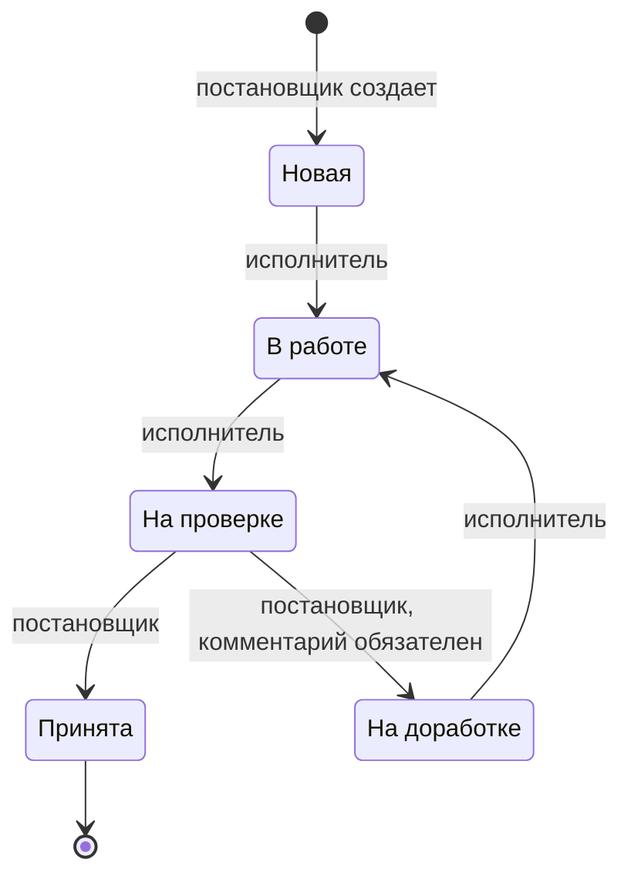

# СтройCRM: мини-CRM «Объекты и задачи»

Небольшая CRM для строительной компании. Постановщик заводит объекты (стройки) и ставит по ним задачи, исполнители берут задачи в работу и отправляют на проверку, постановщик принимает работу или возвращает на доработку с комментарием. Каждая смена статуса попадает в историю.

Все правила доступа и переходы статусов проверяет **база данных** (RLS-политики и триггеры PostgreSQL). Интерфейс только прячет недоступные кнопки: запрос в обход интерфейса упрется в те же правила.

**Демо:** _ссылка после деплоя_

| Роль        | Email                 | Пароль             |
| ----------- | --------------------- | ------------------ |
| Постановщик | `manager@example.com` | _передается в чате_ |
| Исполнитель | `ivanov@example.com`  | _передается в чате_ |
| Исполнитель | `petrov@example.com`  | _передается в чате_ |

Документы для сдачи: [объяснение для руководителя](manager_explanation.md) и [решения и допущения](assumptions.md).

## Стек

- React 18, TypeScript, Vite, React Router, Tailwind CSS, sonner (уведомления)
- Supabase: Auth (email и пароль), PostgreSQL, Row Level Security, триггеры, RPC

## Workflow задачи



Разрешенные переходы хранятся в таблице `task_status_transitions`. По ней проверяет триггер в базе, и по ней же интерфейс решает, какие кнопки показать. Все, чего нет в таблице, запрещено.

## Структура

```
supabase/
  migrations/001_init.sql      схема, RLS-политики, триггеры, RPC смены статуса
  seed.sql                     демо-данные: 3 объекта, 8 задач во всех статусах
  tests/security_checks.sql    47 проверок защиты, запускаются в SQL Editor
src/
  api/                         запросы к Supabase (projects, tasks, profiles)
  components/                  UI: формы, список задач, история, кнопки статусов
  context/AuthContext.tsx      сессия и профиль текущего пользователя
  hooks/useAsyncData.ts        загрузка данных с перезагрузкой и защитой от гонок
  lib/                         клиент Supabase, типы БД, правила workflow для UI, ошибки
  pages/                       экраны: вход, объекты, объект, задача, мои задачи
  types.ts                     доменные типы
```

## Запуск

### 1. Supabase

1. Создайте проект на [supabase.com](https://supabase.com) (бесплатного тарифа достаточно).
2. **Миграция.** SQL Editor → вставьте `supabase/migrations/001_init.sql` → Run.
   Или через Supabase CLI: `npx supabase init` (создаст служебный `config.toml`), `npx supabase link --project-ref <ref>`, `npx supabase db push`.
3. **Закройте регистрацию.** Authentication → Sign In / Providers → выключите «Allow new users to sign up».
4. **Создайте пользователей.** Authentication → Users → Add user → Create new user, отметьте «Auto Confirm User»:
   `manager@example.com`, `ivanov@example.com`, `petrov@example.com`. Пароли придумайте сами, в репозитории их нет.
5. **Демо-данные.** SQL Editor → `supabase/seed.sql` → Run. Скрипт назначит роли и создаст объекты и задачи.
   Действия в нем выполняются от имени сотрудников, поэтому проходят через те же триггеры, что и запросы из приложения. Все записи создаются одной транзакцией, так что время в истории у демо-задач одинаковое.
6. **Проверка защиты (по желанию).** SQL Editor → `supabase/tests/security_checks.sql` → Run. В таблице результата все строки должны быть `OK`. Скрипт ничего не меняет в базе.

Другие email: поменяйте константы в начале `seed.sql` и `security_checks.sql`.
Новый сотрудник: создать пользователя в Authentication → Users и добавить строку в `profiles` (Table Editor или SQL):

```sql
insert into public.profiles (id, full_name, role)
select id, 'Имя Фамилия', 'assignee' from auth.users where email = 'new.person@example.com';
```

### 2. Фронтенд локально

Нужен Node.js 20.19+ или 22+.

```bash
cp .env.example .env   # URL проекта и публичный ключ: Project Settings → API Keys
npm install
npm run dev            # http://localhost:5173
```

В `.env` указывается только публичный ключ (`anon` или `publishable`). Секретный `service_role` ключ во фронтенде не нужен и опасен: все переменные `VITE_` попадают в код страницы. Приложение проверяет ключ при старте и с секретным ключом не запустится, чтобы такая ошибка была заметна сразу (сам ключ после этого нужно перевыпустить).

Другие команды: `npm run build` (проверка типов и сборка), `npm run lint`.

### 3. Деплой на Vercel

1. Add New → Project → импортируйте репозиторий. Vite определится автоматически.
2. Environment Variables: `VITE_SUPABASE_URL`, `VITE_SUPABASE_ANON_KEY`.
3. Deploy. Переходы по ссылкам внутри SPA настроены в `vercel.json` (для Netlify есть `public/_redirects`).

## Как устроена защита

| Требование ТЗ | Как сделано |
| --- | --- |
| Права закрыты на уровне базы | RLS включен на всех таблицах. У анонима отозваны все права. Авторизованным права на запись выданы только на нужные колонки: например, автора и статус при создании задачи клиент передать не может. |
| Исполнитель не читает и не меняет чужие задачи | Политики на `tasks`: исполнитель видит и обновляет только строки, где `assignee_id = auth.uid()`. Объекты и история видны ему только через свои задачи. Чужая задача для него просто «не существует». |
| Переходы статусов проверяет база | Триггер `tasks_before_update` сверяет каждую смену статуса с белым списком `task_status_transitions`, проверяет роль (постановщик или именно назначенный исполнитель) и обязательный комментарий. Исполнителю триггер разрешает менять только статус. |
| Историю нельзя подделать, изменить, удалить | Записи создает только триггер: автор берется из `auth.uid()`, время из `now()`. У клиентов нет прав на запись в `task_history`, а отдельный триггер запрещает INSERT, UPDATE, DELETE и TRUNCATE для любой роли, включая `service_role`. Удаление возможно только каскадом вместе с задачей. |
| Регистрация закрыта | Выключена в настройках Auth. Роль хранится в `profiles`, писать туда может только администратор. Пользователь без профиля не видит ни одной записи. |
| Секреты не во фронтенде и не в репозитории | Во фронтенде только публичный ключ, `.env` в `.gitignore`, в репозитории нет ни ключей, ни паролей. Если в переменные по ошибке подставить `service_role` ключ, приложение не запустится, и ошибку заметят на первом же деплое. |

Смена статуса идет через RPC `change_task_status(task_id, new_status, comment)`. Это функция с правами вызывающего (`security invoker`): RLS к ней применяется как к обычному запросу, а все проверки делает триггер. Функция нужна только чтобы передать комментарий. Прямой `UPDATE tasks SET status = ...` в обход нее проходит через тот же триггер.

### Проверка в обход интерфейса

Самый быстрый способ: `supabase/tests/security_checks.sql` (см. выше). Он выполняет запросы от имени разных пользователей ровно так, как это делает API Supabase.

То же самое через HTTP API, например, исполнитель пытается сам принять свою задачу:

```bash
SUPABASE_URL=https://<ref>.supabase.co
ANON_KEY=<публичный ключ>

TOKEN=$(curl -s "$SUPABASE_URL/auth/v1/token?grant_type=password" \
  -H "apikey: $ANON_KEY" -H "Content-Type: application/json" \
  -d '{"email":"petrov@example.com","password":"<пароль>"}' | jq -r .access_token)

curl -s -X POST "$SUPABASE_URL/rest/v1/rpc/change_task_status" \
  -H "apikey: $ANON_KEY" -H "Authorization: Bearer $TOKEN" -H "Content-Type: application/json" \
  -d '{"p_task_id":"<id задачи на проверке>","p_new_status":"accepted"}'
# {"code":"42501","message":"Перевести задачу в статус «Принята» может только постановщик", ...}
```
